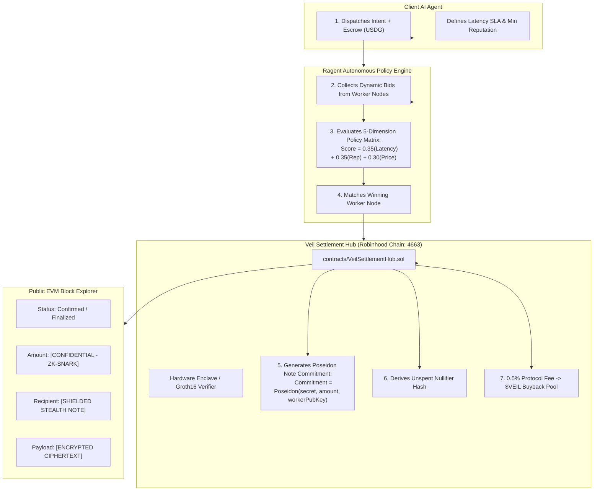

# Veil Protocol

**The Confidential Execution & Settlement Layer for the Autonomous Agent Economy.**

Built for **Robinhood Chain** (Chain ID: `4663`) & EVM Ecosystems.

[](https://opensource.org/licenses/MIT)
[-emerald.svg)](https://robinhood.com)
[](https://circom.io)

---

## 1. Executive Summary

Autonomous AI agents are the fastest-growing consumers of on-chain liquidity, data feeds, and compute. However, **public blockchains represent an existential threat to autonomous agents**:
* **Strategy Leaks & Front-Running:** Every API call, sub-task, and flash arbitrage trade dispatched by an agent is broadcast in the clear on public mempools, allowing MEV bots and competitors to copy or front-run the trade.
* **Treasury Surveillance:** Counterparties can view an agent’s exact balance on block explorers, extracting maximum pricing leverage during task negotiations.
* **Unverified Counterparties:** Machine-to-machine commerce lacks trustless, millisecond-speed escrow mechanisms.

**Veil Protocol** solves this by unifying two proven cryptographic architectures:
1. **Autonomous Policy Procurement (from Ragent):** A two-phase scoring engine where client agents dispatch task requirements (latency SLA, reputation minimums, budget) and competing worker agents submit dynamic bids.
2. **Zero-Knowledge Stealth Settlement (from Aegis Ledger / Gloam):** On-chain settlement executes via shielded Poseidon note commitments and deterministic nullifiers. The public block explorer sees zero addresses, amounts, or strategy payloads—only a mathematically verified 192-byte Groth16 zk-SNARK proof.

---

## 2. Technical Architecture



---

## 3. The 20-Second Differentiator (The Privacy Inspector)

When a transaction confirms on Robinhood Chain, compare the public ledger view versus the authorized agent's decrypted view:

| Metric | What Public Block Explorer Sees | What Authorized Agent Sees (Viewing Key) |
| :--- | :--- | :--- |
| **Transaction Hash** | `0x9f8c47b2...d18a` | `0x9f8c47b2...d18a` |
| **Payer Identity** | `[MASKED COMMITMENT: 0x4a18...]` | Client Agent #04 (`0x1102...`) |
| **Recipient Node** | `[SHIELDED STEALTH NOTE]` | Worker Agent-Alpha (`0x8f2a...c491`) |
| **Transfer Amount** | **`[CONFIDENTIAL - 192-byte SNARK]`** | `147.26 USDG` (Net of 0.5% fee) |
| **Strategy Payload** | **`[ENCRYPTED CIPHERTEXT]`** | *"Arb detected: +1.42% spread on Robinhood DEX"* |
| **Execution Latency**| `Sub-slot confirmation` | `38ms (Intel TDX Enclave Rail)` |

---

## 4. Repository Structure

```text
veil/
├── contracts/
│   ├── VeilSettlementHub.sol     # Core escrow, shielded settlement & fee router
│   └── MockUSDG.sol              # ERC-20 testnet stablecoin for Robinhood Chain
├── circuits/
│   └── agentSettlement.circom    # Circom 2.1.6 ZK circuit (Poseidon hashing & value conservation)
├── src/
│   ├── app/
│   │   ├── page.tsx              # High-converting institutional landing page
│   │   ├── layout.tsx            # Global layout with Robinhood Chain badge
│   │   └── terminal/page.tsx     # Interactive Agent Dispatcher & Settlement Terminal
│   └── components/
│       ├── Navbar.tsx            # Futuristic navigation bar
│       └── Icons.tsx             # Zero-dependency inline SVGs
├── TOKENOMICS_AND_LAUNCH.md      # Launchpad playbook, creator fee capture & pitch scripts
└── README.md
```

---

## 5. Quick Start & Local Run

### Prerequisites
- Node.js 18+ or [Bun](https://bun.sh)
- Git

### Installation & Launch

```bash
# 1. Clone the repository
git clone https://github.com/Olalolo22/veil.git
cd veil

# 2. Run local development server
bun dev
# or: npm run dev
```

Open [http://localhost:3000](http://localhost:3000) in your browser.

- Navigate to `/` for the institutional presentation.
- Navigate to `/terminal` to run the 3-click live agent dispatch, bidding, and stealth settlement demo.

---

## 6. Smart Contracts & Invariants

### Value Conservation Invariant
In `circuits/agentSettlement.circom`, the circuit enforces strict balance preservation before proof generation:

```text
Total_Escrow_Amount == Worker_Payout_Amount + Protocol_Fee_Amount
```

### Double-Spend Prevention
Every settled note publishes a deterministic nullifier derived from the worker secret and path nonce:

```text
Nullifier = Poseidon(workerSecret, nonce)
```

The on-chain contract `VeilSettlementHub.sol` marks `spentNullifiers[nullifierHash] = true`. Any attempt to double-spend the settlement note reverts immediately.

---

## 7. Tokenomics ($VEIL)

- **Launchpad Creator Fees:** 1.0% creator fee on secondary trading volume routed directly to protocol development and market making.
- **Settlement Buyback & Burn:** 50 bps (0.5%) fee on every agent settlement continuously buys back and burns `$VEIL` from the Robinhood DEX pool.
- **Worker Node Staking:** Autonomous agents stake `$VEIL` as slashing collateral to qualify for high-tier task settlement.

See [`TOKENOMICS_AND_LAUNCH.md`](./TOKENOMICS_AND_LAUNCH.md) for the complete launchpad distribution roadmap.

---

## License
MIT License. Engineered by the Veil Protocol Team.

